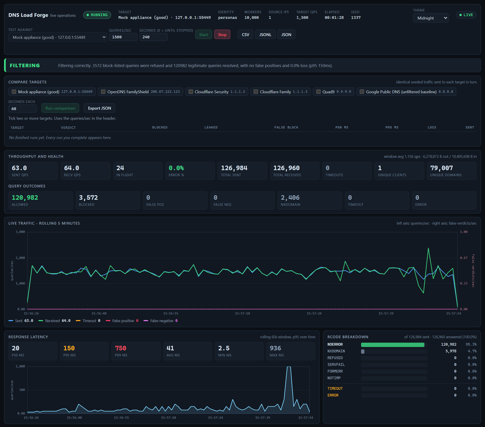
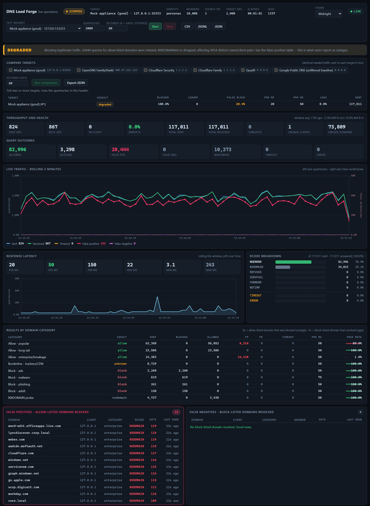

# DNS Load Forge

**Vet a DNS filter with realistic office traffic, and compare filters like for like.**

[](https://github.com/ZachGSnow/dns-load-forge/actions/workflows/ci.yml)
[](pyproject.toml)
[](pyproject.toml)
[](LICENSE)


*Screenshot from a run against the built-in mock appliance, not a real product.*

DNS Load Forge simulates the DNS behaviour of an office of up to **10,000 workers** and
tells you whether the filter in front of them is doing its job. It sends a realistic mix of
traffic that should be **allowed**, traffic that should be **blocked**, and traffic in the
grey zone, measures what actually came back, and gives a verdict you can act on.

It is for the person who has to answer "is this DNS filtering product any good?": an MSP
choosing between vendors, a network team accepting an appliance, anyone who has been told
a filter "blocks threats" and would like to see it do it.

* **Same traffic, any target.** Runs are seeded, so you can send identical traffic to
  several filters in turn and read the results side by side.
* **Scoring that fits the target.** A family-safe resolver is not marked down for letting
  ads through, and a public resolver is not marked down for not knowing `corp.local`.
* **A live dashboard** with five themes, a compare table, and domain lists you can refresh
  from the page.
* **Dependency-free.** Python 3.10+ standard library only; no capture driver, no privileges,
  runs from a USB stick on an isolated segment.

```
python -m dnsloadforge targets                       # what you can test against
python -m dnsloadforge --mock                        # rehearse with no real target
python -m dnsloadforge --target "Quad9" --target "OpenDNS FamilyShield" --qps 100 --duration 120
python -m dnsloadforge --server 10.0.0.10 --qps 2000 --duration 900     # your own appliance
```

> **Responsible use.** This sends real DNS traffic, including lookups of malware and phishing
> domains. Only test infrastructure you own or are authorised to test, and tell whoever
> monitors your network first. Shared public resolvers are limited to 100 qps unless you
> pass `--allow-public-target`. See [SECURITY.md](SECURITY.md).

---

## What it actually tests

Everything runs from **one machine**: one process generates the whole office's traffic
and serves the dashboard.

A DNS filter identifies a client by **source IP**. "10,000 workers" therefore splits
into two different things, and this tool does both:

| Mode | Appliance sees | Needs admin | Use it for |
|---|---|---|---|
| `--mode personas` (default) | one source IP, 10,000 **logical** clients | no | throughput, classification, false positives/negatives |
| `--mode pool` | **real distinct source IPs** | yes, plus a NIC with the addresses | per-client policy, group policy, reporting/attribution |

Pool mode is the higher-fidelity option, but be clear-eyed about the ceiling: a laptop
will not carry 10,000 real addresses. `New-LabSourceIPs.ps1` caps you at 1,024 by
default and refuses Wi-Fi, because adding thousands of addresses to a wireless NIC
destroys the host's connectivity. A few hundred real clients plus realistic traffic
characteristics is far more informative than nothing, and the persona model carries
the realism that raw IP count cannot.

## Install

There is nothing to install: clone the repository and run it from `src/` (or use the
PowerShell wrapper in `scripts/`). To get a `dnsloadforge` command on your PATH:

```bash
pip install .            # or: pip install -e .  while developing
dnsloadforge --version
```

Fetched domain lists are cached in `lists/cache/` inside a checkout, or in
`%LOCALAPPDATA%\dnsloadforge` / `~/.cache/dnsloadforge` for an installed copy. Set
`DNSLOADFORGE_CACHE` to put them anywhere else.

## Quick start

```powershell
# Rehearse the whole flow against a simulated appliance -- no lab, no risk.
# -Mock defaults to 2000 qps because the simulated appliance is a single-threaded
# responder that saturates well below what the generator can send; pass -Qps to push
# it harder, and you will get the DEGRADED capacity verdict instead of a clean pass.
.\scripts\Invoke-DnsLoadForge.ps1 -Mock -Duration 20

# Vet a real appliance.
.\scripts\Invoke-DnsLoadForge.ps1 -Server 10.0.0.10 -Qps 10000 -Duration 900 -RecordLog .\runs\soak.jsonl

# Find out what this machine can actually generate before blaming anyone.
python -m dnsloadforge bench
```

Or drive it directly:

```bash
cd src
python -m dnsloadforge doctor                    # readiness check before you travel
python -m dnsloadforge targets                   # the named targets available to test
python -m dnsloadforge lists                     # what is in the domain catalogue
python -m dnsloadforge --server 10.0.0.10        # run, with the dashboard on :8787
python -m dnsloadforge serve --server 10.0.0.10  # dashboard only; press Start yourself
```

The dashboard is served at <http://127.0.0.1:8787/> and stays up after the run ends so
you can read the report. Press Ctrl-C to exit.

## Targets

A resolver is not just an address. What counts as a failure depends on what it is *meant*
to do, so each target carries its own scoring rules:

| Field | Meaning |
|---|---|
| `kind` | `appliance` (a filter in front of your network: internal names such as `corp.local` must resolve) or `public` (a shared cloud resolver: NXDOMAIN for internal names is correct, and load above 100 qps needs `--allow-public-target`) |
| `blocks` | the categories it should block. The others are still sent, because they are realistic traffic, but are reported and never judged. `[]` makes an unfiltered baseline. |
| `sinkhole_ips`, `sinkhole_cidrs` | what "blocked" looks like for this target. OpenDNS, for example, answers a blocked name with an address on its block page rather than NXDOMAIN. |

A few well-known public filters are built in (`python -m dnsloadforge targets`). They
describe each service's published behaviour at the time of writing, so check them against
current documentation before you rely on a verdict. Add your own in `targets.json` (copy
[`targets.example.json`](targets.example.json)); an entry with the same name replaces a
preset.

```bash
python -m dnsloadforge --target "Quad9"                 # one named target
python -m dnsloadforge --server 10.0.0.10               # a bare address: scored as an appliance
python -m dnsloadforge --server 10.0.0.10 --target-kind public
```

Two scoring rules apply to every target. NXDOMAIN for a reverse-DNS (`*.arpa`) name is
never a finding, because most addresses have no PTR record. And for `public` targets,
NXDOMAIN for internal-only suffixes (`.local`, `.corp`, `.internal`, ...) is correct, not a
false positive.

## Comparing filters

Name several targets and they run back to back on **identical, seeded traffic**, then print
side by side:

```bash
python -m dnsloadforge --target "Quad9" --target "Cloudflare Security" --qps 100 --duration 120
```

```
COMPARISON (same seed and traffic for every target)
  target    verdict    blocked  leaked  false block  p50   p95   timeouts  sent
  Filter A  FILTERING  97.1%    9       0.0%         19ms  41ms  0.2%      12,012
  Filter B  DEGRADED   81.4%    52      1.9%         11ms  28ms  0.1%      12,010
```

*(the layout is real; these numbers and names are placeholders. Your results depend on your
network, the targets and the day's threat feeds.)*

* **blocked** is the share of expected-block queries that were blocked; **leaked** is how
  many resolved instead; **false block** is the share of expected-allow queries that were
  wrongly blocked.
* Targets run **one after another**, never in parallel, so the generator and your NIC are
  not the thing being compared. Each gets a short cooldown first.
* In the dashboard, tick two or more targets under **Compare targets** and press **Run
  comparison**. Every finished run, comparison or not, lands in the table, and **Export
  JSON** saves it.

## The dashboard

Near-real-time, updated once a second over Server-Sent Events:

* **Verdict banner** - the headline answer, colour-coded.
* **Live traffic chart** - sent/received per second over a rolling 5-minute window,
  with false positives and false negatives on their own axis so the most important
  signal cannot be lost among the traffic lines.
* **Latency** - p50/p95/p99 cards plus a p95-over-time area chart.
* **RCODE breakdown** - including the timeout and generator-error buckets, which are
  shares of queries *sent* rather than received, since they never arrived.
* **By-category table** - every category with its expectation, counts, pass rate.
* **Top domains / top clients**, sortable.
* **False positives / false negatives** - the money tables.
* **Compare targets** - pick targets, run them on identical traffic, read the table.
* **Domain lists** - what mix was actually loaded, and a **Sources** table to refresh each
  list, refresh them all, or switch one off. List changes happen between runs only, because
  re-parsing a million-name list would otherwise distort the latency being measured. A
  refresh needs internet; a failed or empty download keeps the cached copy.
* **Themes** - Midnight (default), Grove, Tidal Ember, Dusk and Ink & Wheat, chosen from
  the header and remembered per browser. Text contrast is checked in every one.

`GET /api/stats` returns the same snapshot as JSON, `GET /api/stream` is the SSE feed,
and `POST /api/control` starts and stops runs (`{"action":"start","target":"Quad9"}`,
`{"action":"compare","targets":[...],"duration_s":60}`, `{"action":"stop"}`). `GET
/api/history` returns the finished runs, and `/api/sources` with `POST
/api/sources/refresh` and `/api/sources/enabled` manage the domain lists. The per-query
evidence is downloadable as CSV, JSONL or JSON.

The dashboard can start load tests and has no login, so it only answers on `127.0.0.1`: it
refuses cross-origin writes, non-JSON writes and DNS-rebinding requests, and binding it
anywhere else needs `--allow-remote-dashboard`. Details in [SECURITY.md](SECURITY.md).

## Reading the verdict

| Verdict | Meaning | What to do |
|---|---|---|
| **idle** | no run yet | press Start |
| **unknown** | fewer than 200 completed queries | run longer; a verdict from a handful of packets is noise |
| **filtering** | blocked what it should, allowed what it should, no false positives | nothing |
| **baseline** | nothing is expected to be blocked for this target (an unfiltered control) | use it as the reference to compare filters against |
| **passthrough** | answering, but blocking almost nothing | **the policy is not being applied** - check the appliance's client scope, its forwarding rules, and that the clients actually point at it |
| **degraded** | working but harming or failing | read the note: blocking legitimate traffic, leaking known-bad, or failing under load |

`degraded` resolves into three genuinely different situations, and the note says which:

* **Blocking legitimate traffic** - allow-listed domains came back `REFUSED`,
  `NXDOMAIN`, sinkholed or dropped. This is what users report as an outage. The
  false-positive table names every affected domain, category and client.
* **Leaking known-bad traffic** - block-listed domains resolved to real addresses.
  The filter is active; its lists are incomplete.
* **Failing under load** - more than 5% of queries never answered or came back
  `SERVFAIL`. This is a capacity or upstream problem, not a policy one.

Here is the first case, produced with `--mock --mock-overblock`: the mock appliance
wrongly blocks the enterprise list, the verdict turns `DEGRADED`, the false-positive
line climbs on the traffic chart, and the table names every broken domain.



## What gets generated

The point of the tool is the *shape* of the traffic, not just the volume.

**11 roles, summing to exactly 10,000 seats** - knowledge worker (3,800), contact
centre, sales/marketing, developer, guest/BYOD, finance/HR, kiosk, IT/helpdesk, IoT
device, executive, server/infrastructure. Each has its own domain-category mix, query
type mix, query intensity and burst size. A printer and a developer do not look alike.

**Repeat sets, because caching is real.** Each worker keeps a hot set of a few dozen
names it comes back to (mail, the intranet, an analytics beacon) and draws roughly 70%
of its lookups from that set. Without this every client looks identical and per-client
policy testing is meaningless.

**Compound Poisson arrivals.** A worker opens a page and 1-20 lookups go out at once.
That burstiness is what breaks a resolver which is fine at the same *average* rate - so
it is modelled explicitly rather than smoothed away.

**Nine categories, weighted so the mix is realistic:**

| Category | Expectation | Source |
|---|---|---|
| Allow - popular | must resolve | Cisco Umbrella top 1M, Tranco top 1M |
| Allow - long tail | must resolve | Majestic Million |
| Allow - enterprise/breakage | must resolve | curated: M365 sign-in, Windows Update, CRL/OCSP, AD `_srv._tcp` names, CDNs |
| Borderline - trackers/CDN | reported, **never judged** | Block List Project tracking |
| Block - ads | must block | Block List Project ads, StevenBlack unified |
| Block - malware | must block | URLhaus, Block List Project malware |
| Block - phishing | must block | Phishing Army, Block List Project phishing + scam |
| Block - adult | must block | Block List Project porn |
| NXDOMAIN probe | must not exist | generated at runtime (DGA-like names) |

**Query types** follow modern browser reality: ~70-80% `A`, 10-16% `AAAA`, 4-10%
`HTTPS`/`SVCB`, plus `TXT`, `PTR`, `SRV`, `MX`, `NS`. `HTTPS`/`SVCB` matter because a
lot of appliances get type 65 wrong.

**Sizing check.** At 10,000 qps across 10,000 clients each desk is doing ~3,600
queries/hour, which is a genuinely busy peak hour. Use `--qps` to change the volume
without changing the shape of the office.

## Domain lists

```bash
python -m dnsloadforge lists --refresh     # fetch (needs internet)
python -m dnsloadforge lists               # show what is cached
python -m dnsloadforge lists --json        # machine-readable
```

Sources live in `src/dnsloadforge/sources.json` - a dead or retired list is a one-line
edit, not a code change. The dashboard's Sources table refreshes or switches them off
without touching that file (the choice is stored in `disabled.json` beside the cache). Cached under `lists/cache/` with a manifest recording fetch
time, ETag and count; cache is trusted for 7 days. `--offline` never touches the
network, which is the normal state of affairs on-site.

Two decisions worth knowing about:

* **Superset lists are excluded on purpose.** A domain belongs to exactly one
  category, so when two lists disagree the more specific one wins. StevenBlack's
  `alternates/*` files are the base list *plus* extensions - using one for adult
  content silently reclassified all 72,526 ad domains as adult and emptied the ads
  category. Single-topic lists keep each category its own.
* **Conflicting popularity entries are re-filed, not dropped.** 46,342 names (2.65% of
  the popular list, clustered at the head) are subdomains of something block-listed -
  `enduser.adsvr.org` under `adsvr.org`. A filter blocking `adsvr.org` is doing what its
  list says, so scoring those as false positives would fail every appliance and hide
  real findings. They are moved to `borderline`: still generating traffic, never judged.
  Exception: **enterprise** names are kept even when they conflict, because an appliance
  blocking the tree above the Microsoft sign-in domain is the single most valuable thing
  this tool can tell you.

The default `--max-per-category 250000` keeps the popular head and the high-confidence
block entries while bounding startup to ~16 s and ~350 MB. The full set is ~6.5 M
domains and would cost a gigabyte and twenty seconds for a long tail that barely moves
the statistics.

## Rehearsing without an appliance

The built-in mock appliance lets you exercise everything - including failure - with no
lab and no risk:

```bash
python -m dnsloadforge mock --port 5353 --scenario overblocker   # standalone
python -m dnsloadforge --mock                                    # as the target of a run
```

| Scenario | Simulates |
|---|---|
| `good` | an honest filter: blocks exactly what the catalogue says |
| `passthrough` | deployed but not enforcing (the most common real finding) |
| `overblocker` | blocks legitimate/enterprise domains too |
| `lossy` | overload: 15% of queries dropped |
| `servfail` | failing under load: 30% SERVFAIL |
| `slow` | saturated link: 150 ms ± 100 ms |
| `refused` | broken ACL: REFUSED for everything |

`--mock-overblock` makes the quickstart rehearsal produce a real false-positive report,
so you can see what a failing appliance looks like before you find one.

## Wire-side verification (optional)

Sender-side statistics are exact about what was *sent*, but they cannot see packets
dropped between the NIC and the appliance. `pktmon.exe` ships with Windows, so no
third-party driver is needed:

```powershell
.\scripts\Get-DnsLoadForgeCapture.ps1 -Server 10.0.0.10 -Action Start -DurationSeconds 60
.\scripts\Get-DnsLoadForgeCapture.ps1 -Server 10.0.0.10 -Action Stop
.\scripts\Get-DnsLoadForgeCapture.ps1 -Action Reconcile -CaptureFile .\scripts\captures\<file>.pcapng -SenderLog .\runs\soak.jsonl
```

`Reconcile` compares *queries seen on the wire* against the generator's own count and
tells you what the delta means. It parses pcapng itself, so tshark is not required.
Needs elevation, and adds measurable ETW overhead - use it for spot checks, not for a
full 10,000 qps soak.

## Tests

```bash
cd dns-load-forge
python -m unittest discover -s tests -t tests -v
```

270 tests, no network access required. The ones that matter most are the seven
end-to-end verdict scenarios in `tests/test_engine.py`, which drive real UDP at a real
mock appliance and assert that an honest filter is reported as `filtering` **while** a
passthrough, overblocking and lossy filter each produce a different, correct verdict.
`test_an_honest_filter_scores_no_findings_under_a_realistic_mix` is the canary: it uses
the shipped role mixes with repeat-set behaviour enabled, so a single mis-attributed
category on the hot path makes a perfectly good filter look like it is blocking
legitimate traffic.

`tests/test_cli.py` covers the command surface and the safety guards, and exists
because two bugs were only ever visible end to end: `serve --mock` silently ignored
`--mock` and aimed a run at `127.0.0.1:53`, and `serve` skipped preflight entirely, so
the public-resolver guard could be bypassed by picking a different verb. Both are real
traffic against a real target, so both are pinned by wiring tests that drive the actual
command functions.

## Commands

| Command | Purpose |
|---|---|
| `run` (default) | simulate and serve the dashboard |
| `serve` | dashboard only, start the run yourself when the change window opens |
| `lists` | show or fetch the domain catalogue |
| `targets` | list the named targets: built-in presets plus `targets.json` |
| `mock` | run the simulated appliance standalone |
| `bench` | measure what this machine can generate |
| `doctor` | check readiness: Python, elevation, source address, lists, target reachability |

Running with no command defaults to `run`, so `python -m dnsloadforge --server 1.2.3.4`
does the obvious thing.

## Limitations, stated plainly

* **Persona mode cannot test per-client policy.** One source IP - the appliance will
  attribute all 10,000 clients to one entry. Use pool mode when identity matters.
* **`achieved qps` is measured over the sending window**, excluding the drain at the
  end, so it is comparable to your `--qps` target rather than depressed by the
  collection of stragglers.
* **Three different rates, deliberately.** `error_pct` is run-cumulative loss over
  queries actually sent; `window_error_pct` is the share of recent *outcomes* that
  failed, so a problem shows immediately rather than being diluted by the run's
  healthy history; `dropped_pct` is intended traffic the sender never offered because
  the in-flight budget was full. If `dropped_pct` is non-zero the generator was the
  bottleneck, and the verdict note says so rather than letting you blame the
  appliance.
* **Percentiles come from histograms.** Latency is bucketed (fine-grained below
  100 ms), and a percentile is reported as the *upper bound* of its bucket, so values
  are a slight over-estimate rather than a flattering one. Per-domain latency uses a
  coarser 8-bucket histogram to keep memory bounded.
* **A filter that blocks `A` but answers `HTTPS` for a blocked name is not
  distinguished** from one that blocks properly. It is leaking connectivity in
  practice, since an `HTTPS` record carries the address, but this classifier does not
  call it out.
* **Domain lists are a snapshot.** Threat feeds churn daily; the cache is deliberately
  trusted for 7 days so two runs stay comparable. Refresh before a formal validation.
* **Presets are not a certification.** The built-in targets encode each service's
  published behaviour, which changes. A verdict against one is only as good as that
  description; override it in `targets.json` when the service's documentation differs.
* **One host per run.** All traffic comes from the machine running the tool. There is
  no coordination between machines: copies started on several hosts are separate tests
  with separate verdicts, and with the same `--seed` they send identical traffic rather
  than splitting one office between them. For more distinct clients, use pool mode; for
  more throughput, raise `--threads`.
* **This is a real load generator.** 10,000 qps is a busy office's peak hour, sent on
  top of whatever production traffic is already there. That can saturate a small
  appliance or a firewall's DNS proxy, and it is real extra load on any production
  resolver, so run it in a change window. Well-known public resolvers are refused above
  100 qps unless you pass `--allow-public-target`. The `--mock` path exists so you never
  have to find out the hard way.

## Contributing

See [CONTRIBUTING.md](CONTRIBUTING.md). Read [ARCHITECTURE.md](ARCHITECTURE.md) first.

## License

[MIT](LICENSE) © Zach Snow
