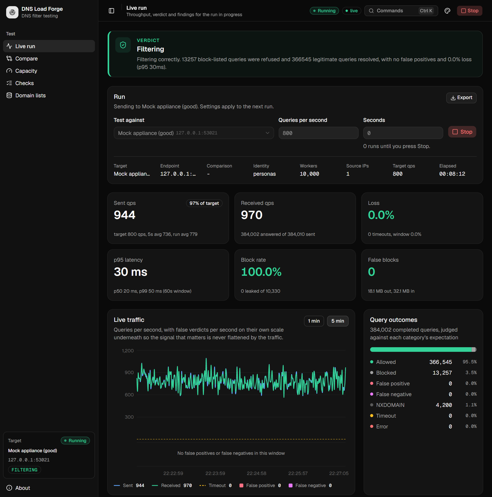
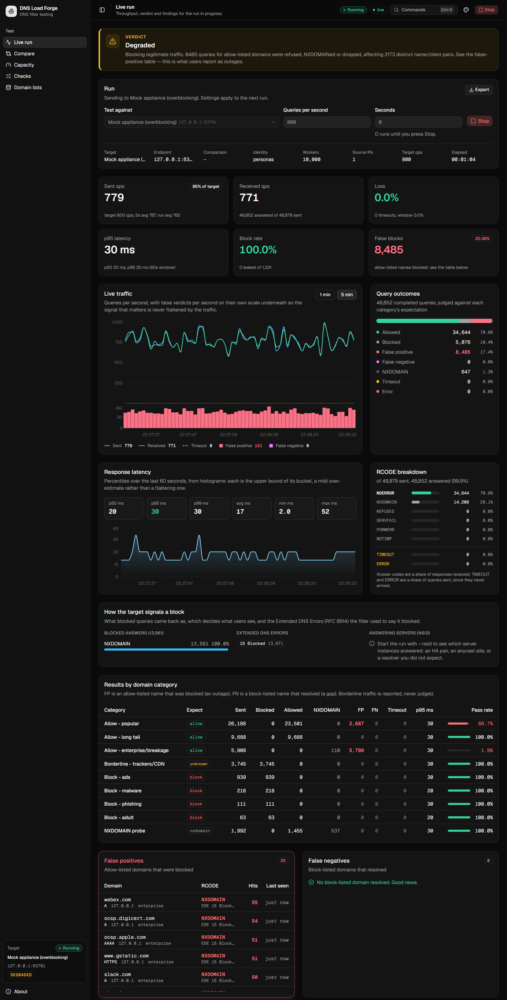

# DNS Load Forge

**Vet a DNS filter with realistic office traffic, and compare filters like for like.**

[](https://github.com/ZachGSnow/dns-load-forge/actions/workflows/ci.yml)
[](pyproject.toml)
[](pyproject.toml)
[](LICENSE)


*Screenshot from a run against the built-in mock appliance, not a real product.*

DNS Load Forge simulates the DNS behaviour of an office of up to **10,000 workers** and
tells you whether the filter in front of them is doing its job. It sends a realistic mix of
traffic that should be **allowed**, traffic that should be **blocked**, and traffic in the
grey zone, measures what actually came back, and gives a verdict you can act on.

It is for the person who has to answer "is this DNS filtering product any good?": an MSP
choosing between vendors, a network team accepting an appliance, anyone who has been told
a filter "blocks threats" and would like to see it do it.

* **Same traffic, any target, any transport.** Runs are seeded, so you can send identical
  traffic to several filters in turn, over UDP, TCP, DNS over TLS or DNS over HTTPS, and
  read the results side by side.
* **Scoring that fits the target.** A family-safe resolver is not marked down for letting
  ads through, and a public resolver is not marked down for not knowing `corp.local`.
* **A live dashboard** built with Tailwind CSS and shadcn/ui: verdict, live charts, findings
  tables, side-by-side comparisons and domain lists you can refresh from the page, in light
  or dark and five palettes.
* **Dependency-free.** Python 3.10+ standard library only; no capture driver, no privileges,
  runs from a USB stick on an isolated segment. The dashboard is one self-contained page
  that makes no request beyond the tool itself.

```
python -m dnsloadforge targets                       # what you can test against
python -m dnsloadforge --mock                        # rehearse with no real target
python -m dnsloadforge --target "Quad9" --target "OpenDNS FamilyShield" --qps 100 --duration 120
python -m dnsloadforge --server 10.0.0.10 --qps 2000 --duration 900     # your own appliance
```

> **Responsible use.** This sends real DNS traffic, including lookups of malware and phishing
> domains. Only test infrastructure you own or are authorised to test, and tell whoever
> monitors your network first. Shared public resolvers are limited to 100 qps unless you
> pass `--allow-public-target`. See [SECURITY.md](SECURITY.md).

---

## What it actually tests

Everything runs from **one machine**: one process generates the whole office's traffic
and serves the dashboard.

A DNS filter identifies a client by **source IP**. "10,000 workers" therefore splits
into two different things, and this tool does both:

| Mode | Appliance sees | Needs admin | Use it for |
|---|---|---|---|
| `--mode personas` (default) | one source IP, 10,000 **logical** clients | no | throughput, classification, false positives/negatives |
| `--mode pool` | **real distinct source IPs** | yes, plus a NIC with the addresses | per-client policy, group policy, reporting/attribution |

Pool mode is the higher-fidelity option, but be clear-eyed about the ceiling: a laptop
will not carry 10,000 real addresses. `New-LabSourceIPs.ps1` caps you at 1,024 by
default and refuses Wi-Fi, because adding thousands of addresses to a wireless NIC
destroys the host's connectivity. A few hundred real clients plus realistic traffic
characteristics is far more informative than nothing, and the persona model carries
the realism that raw IP count cannot.

## Install

There is nothing to install: clone the repository and run it from `src/` (or use the
PowerShell wrapper in `scripts/`). To get a `dnsloadforge` command on your PATH:

```bash
pip install .            # or: pip install -e .  while developing
dnsloadforge --version
```

Fetched domain lists are cached in `lists/cache/` inside a checkout, or in
`%LOCALAPPDATA%\dnsloadforge` / `~/.cache/dnsloadforge` for an installed copy. Set
`DNSLOADFORGE_CACHE` to put them anywhere else.

## Quick start

```powershell
# Rehearse the whole flow against a simulated appliance -- no lab, no risk.
# -Mock defaults to 2000 qps because the simulated appliance is a single-threaded
# responder that saturates well below what the generator can send; pass -Qps to push
# it harder, and you will get the DEGRADED capacity verdict instead of a clean pass.
.\scripts\Invoke-DnsLoadForge.ps1 -Mock -Duration 20

# Vet a real appliance.
.\scripts\Invoke-DnsLoadForge.ps1 -Server 10.0.0.10 -Qps 10000 -Duration 900 -RecordLog .\runs\soak.jsonl

# Find out what this machine can actually generate before blaming anyone.
python -m dnsloadforge bench
```

Or drive it directly:

```bash
cd src
python -m dnsloadforge doctor                    # readiness check before you travel
python -m dnsloadforge targets                   # the named targets available to test
python -m dnsloadforge lists                     # what is in the domain catalogue
python -m dnsloadforge --server 10.0.0.10        # run, with the dashboard on :8787
python -m dnsloadforge serve --server 10.0.0.10  # dashboard only; press Start yourself
```

The dashboard is served at <http://127.0.0.1:8787/> and stays up after the run ends so
you can read the report. Press Ctrl-C to exit.

## Targets

A resolver is not just an address. What counts as a failure depends on what it is *meant*
to do, so each target carries its own scoring rules:

| Field | Meaning |
|---|---|
| `kind` | `appliance` (a filter in front of your network: internal names such as `corp.local` must resolve) or `public` (a shared cloud resolver: NXDOMAIN for internal names is correct, and load above 100 qps needs `--allow-public-target`) |
| `blocks` | the categories it should block. The others are still sent, because they are realistic traffic, but are reported and never judged. `[]` makes an unfiltered baseline. |
| `sinkhole_ips`, `sinkhole_cidrs` | what "blocked" looks like for this target. OpenDNS, for example, answers a blocked name with an address on its block page rather than NXDOMAIN. |
| `transport`, `tls_name`, `doh_path`, `ca_file` (or `url`) | how to reach it: see [Encrypted DNS and TCP](#encrypted-dns-and-tcp) |

A few well-known public filters are built in (`python -m dnsloadforge targets`). They
describe each service's published behaviour at the time of writing, so check them against
current documentation before you rely on a verdict. Add your own in `targets.json` (copy
[`targets.example.json`](targets.example.json)); an entry with the same name replaces a
preset.

```bash
python -m dnsloadforge --target "Quad9"                 # one named target
python -m dnsloadforge --server 10.0.0.10               # a bare address: scored as an appliance
python -m dnsloadforge --server 10.0.0.10 --target-kind public
```

Two scoring rules apply to every target. NXDOMAIN for a reverse-DNS (`*.arpa`) name is
never a finding, because most addresses have no PTR record. And for `public` targets,
NXDOMAIN for internal-only suffixes (`.local`, `.corp`, `.internal`, ...) is correct, not a
false positive.

## Comparing filters

Name several targets and they run back to back on **identical, seeded traffic**, then print
side by side:

```bash
python -m dnsloadforge --target "Quad9" --target "Cloudflare Security" --qps 100 --duration 120
```

```
COMPARISON (same seed and traffic for every target)
  target    verdict    blocked  leaked  false block  p50   p95   timeouts  sent
  Filter A  FILTERING  97.1%    9       0.0%         19ms  41ms  0.2%      12,012
  Filter B  DEGRADED   81.4%    52      1.9%         11ms  28ms  0.1%      12,010
```

*(the layout is real; these numbers and names are placeholders. Your results depend on your
network, the targets and the day's threat feeds.)*

* **blocked** is the share of expected-block queries that were blocked; **leaked** is how
  many resolved instead; **false block** is the share of expected-allow queries that were
  wrongly blocked.
* Targets run **one after another**, never in parallel, so the generator and your NIC are
  not the thing being compared. Each gets a short cooldown first.
* In the dashboard, tick two or more targets under **Compare targets** and press **Run
  comparison**. Every finished run, comparison or not, lands in the table, and **Export
  JSON** saves it.

## Finding the limit

A run at one rate tells you whether the target copes with it. `capacity` tells you how
much it can take: it raises the rate step by step, each step a run of the same office
traffic, until a step breaks a limit you set, then narrows it down between the last step
that passed and the first that failed.

```bash
python -m dnsloadforge capacity --server 10.0.0.10 --max-qps 30000
python -m dnsloadforge capacity --server 10.0.0.10 --slo-p95 50 --require 8000   # exit 1 below 8,000 qps
```

```
  step  6  ramp        1,500 qps  PASS       p95     20 ms  loss 0.0%
  step  7  ramp        2,300 qps  PASS       p95     30 ms  loss 0.1%
  step  8  ramp        3,400 qps  FAIL       p95    150 ms  loss 2.4% (limit 1%); p95 150 ms (limit 100 ms)
  step  9  refine      2,800 qps  PASS       p95     50 ms  loss 0.3%
  step 10  refine      3,100 qps  FAIL       p95    150 ms  p95 150 ms (limit 100 ms)

  Sustains 2,800 qps (p95 50 ms, loss 0.3%). At 3,100 qps: p95 150 ms (limit 100 ms).
```

*(the layout is real; the numbers are placeholders)*

| Option | Default | Meaning |
|---|---|---|
| `--start-qps`, `--max-qps` | 200, 20000 | the first rate, and the highest the search will try |
| `--growth` | 1.5 | each ramp step is this many times the last |
| `--step-seconds` | 20 | how long each step runs |
| `--refine` | 2 | steps that bisect between the last pass and the first failure |
| `--slo-loss`, `--slo-servfail` | 1 | most timeouts and errors (% of queries), and most SERVFAIL (% of answers) |
| `--slo-p95` | 100 | highest p95 latency, in ms |
| `--require QPS` | | exit 1 unless the target sustains at least this rate |

A step also breaks when more than 0.5% of answers carry Extended DNS Error 31 (Rate
Limited) or 32 (Over Quota): the target saying itself that it is shedding load. Before any
of that, the search checks that **this machine** reached the rate. A step it could not send
is no evidence about the target, so the search stops there and says so (`--threads`, or a
faster machine) rather than reporting its own limit as the target's. The Capacity page in
the dashboard runs the same search, shows each step live, and charts p95 and loss by rate.
The public-resolver guard applies to the highest rate a search may reach.

## Encrypted DNS and TCP

A filter has to hold on every road a client takes to it. Browsers resolve over DNS over
HTTPS, Android's Private DNS and Windows 11 over DNS over TLS, and large answers fall back
to TCP, so the same office traffic can be sent over any of them:

```bash
python -m dnsloadforge --server 10.0.0.10 --transport tls        # DoT on 853, certificate checked
python -m dnsloadforge --doh-url https://doh.lab.example/dns-query --server 10.0.0.10
python -m dnsloadforge --target "Cloudflare Family" --target "Cloudflare Family over DoH" --qps 50 --duration 120
```

| Flag | Meaning |
|---|---|
| `--transport` | `udp` (default), `tcp`, `tls` (DNS over TLS, port 853) or `https` (DNS over HTTPS, port 443) |
| `--doh-url` | a DoH endpoint as services publish it; `--server` pins the address, so finding the server does not depend on the DNS you are testing |
| `--tls-name` | the name on the server's certificate, when `--server` is an address |
| `--ca-file` | trust these CA certificates instead of the system's: an appliance with its own CA |
| `--insecure` | skip the certificate check (still encrypted, but not authenticated) |
| `--connections` | connections per thread: TCP and DoT default to 4; DoH sizes its pool to the rate and grows it |

In `targets.json` the same settings are `transport`, `tls_name`, `doh_path` and
`ca_file`, or `url` for a DoH endpoint. The presets include FamilyShield and Cloudflare
Family over DoH, Cloudflare Family and Quad9 over DoT, and Google over DoH as an unfiltered
baseline. Comparing a service with its encrypted variant shows whether encrypted DNS is
filtered the same way and what it costs in latency.

Connections are opened before the first query, so no handshake is counted as latency, and
the dashboard shows the pool: connections opened and lost, queries re-sent, and any
dropped because every connection was busy. TCP and DoT pipeline queries and match answers
by ID; DoH sends one request at a time on each HTTP/1.1 keep-alive connection. A query left
waiting when a server closes its connection is sent once more on another, as a resolver
library would.

* **HTTP/1.1 only.** HTTP/2 is not in Python's standard library. A service that insists on
  it answers `505` (Quad9 does), and the preflight check says so; test it over DoT.
* **On Windows, a root certificate may not be there yet.** Windows downloads root
  certificates the first time something needs one, and Python only sees the ones already
  downloaded. If a check fails with "does not lead to a root this machine trusts", open
  `https://<host>/` once in a browser and run it again.
* **The mock has no certificate.** `--mock --transport tls` rehearses DoT as TCP and
  `--mock --transport https` rehearses DoH over plain HTTP; the TLS itself is exercised only
  against a real server.

## Deployment checks

Before the load test, check how the filter is deployed. Each check is a handful of single
queries, and every result shows the queries and answers behind it.

```bash
python -m dnsloadforge checks --target "OpenDNS FamilyShield"
python -m dnsloadforge checks --server 10.0.0.10 --json      # the evidence, for a report
```

| Group | Check | What it looks at |
|---|---|---|
| Resolver | Who answers | NSID and the whoami services: which servers answer, the egress address and its AS, whether a client subnet is passed upstream, a reported software version |
| This network | DNS interception | a query to `192.0.2.1`, where no DNS server lives: any answer means DNS on the path is intercepted |
| | Plain DNS bypass | whether Google, Cloudflare and Quad9 answer directly on port 53 |
| | Encrypted DNS bypass | whether their DNS-over-HTTPS (443) and DNS-over-TLS (853) endpoints are reachable |
| Encrypted DNS | Firefox canary | `use-application-dns.net` must not resolve, or Firefox may turn on DoH by itself |
| | iCloud Private Relay | both `mask.icloud.com` and `mask-h2.icloud.com` must be blocked, or Private Relay starts |
| | Designated resolvers | the DDR designation (RFC 9462): which encrypted endpoints devices will upgrade to |
| Security | DNSSEC validation | `dnssec-failed.org` must fail; a signed name should come back authenticated |
| | Rebinding protection | whether public names may answer with private addresses |
| Content controls | SafeSearch | Google, YouTube, Bing and DuckDuckGo enforcement (a warning when the target is meant to block adult content) |
| Policy | Vendor test domains | Umbrella's, Cloudflare's, Quad9's and Palo Alto's own test names: whose policy is live |
| | Every query type | names blocked for A must also be blocked for AAAA, HTTPS, TXT and MX |

The "this network" checks describe the machine you run them from, and send a few packets to
public resolvers; `--no-network` leaves them out. Vendors change their test names and
block pages, so a check that looks wrong is worth reading at the evidence level. The
expected answers were checked against live resolvers on 2026-11-26.

## The dashboard

Near-real-time, updated once a second over Server-Sent Events, with five pages:

* **Live run** - the run in progress.
  * **Verdict** - the headline answer, colour-coded, with the reason.
  * **Run** - pick a target, a rate and a duration; Start and Stop.
  * **Headline cards** - sent and received qps, loss, p95 latency, block rate and false
    blocks.
  * **Live traffic** - sent/received/timeouts per second over a rolling 5 minutes, with
    false positives and false negatives on their own scale underneath so the most
    important signal cannot be lost among the traffic lines.
  * **Query outcomes and RCODE breakdown** - including the timeout and generator-error
    buckets, which are shares of queries *sent* rather than received, since they never
    arrived.
  * **Latency** - p50/p95/p99 plus p95 over time.
  * **How the target signals a block** - NXDOMAIN, a block page, a refusal; the
    Extended DNS Errors it sent; and, with `--nsid`, which servers answered.
  * **Results by category** - every category with its expectation, counts and pass rate.
  * **False positives / false negatives** - the money tables.
  * **Top domains / top clients**, sortable.
* **Compare** - tick targets, run them on identical traffic, and read the table and charts.
* **Capacity** - the capacity search above: each step live, the answer, and p95 and loss
  charted by rate.
* **Checks** - the deployment checks above, grouped, with the evidence behind each result.
* **Domain lists** - what mix was actually loaded, and a **Sources** table to refresh each
  list, refresh them all, or switch one off. List changes happen between runs only, because
  re-parsing a million-name list would otherwise distort the latency being measured. A
  refresh needs internet; a failed or empty download keeps the cached copy.

`Ctrl K` opens a command palette (start, stop, go to a page, export, switch theme). Themes
are Light, Dark and System plus the original five palettes (Midnight, Grove, Tidal Ember,
Dusk, Ink & Wheat), remembered per browser; text contrast is tested in every one. Open the
page with `?demo=1` to see it with generated data and no backend.

`GET /api/stats` returns the same snapshot as JSON, `GET /api/stream` is the SSE feed,
and `POST /api/control` starts and stops runs (`{"action":"start","target":"Quad9"}`,
`{"action":"compare","targets":[...],"duration_s":60}`,
`{"action":"capacity","target":"...","max_qps":20000}`, `{"action":"stop"}`). `GET
/api/history` returns the finished runs (`POST /api/history/clear` forgets them), `GET /api/capacity` the
capacity search, `GET /report` the printable report, `GET /metrics` Prometheus metrics, and `/api/sources` with `POST
/api/sources/refresh` and `/api/sources/enabled` manage the domain lists. The per-query
evidence is downloadable as CSV, JSONL or JSON.

The dashboard can start load tests and has no login, so it only answers on `127.0.0.1`: it
refuses cross-origin writes, non-JSON writes and DNS-rebinding requests, cannot be framed by
another site, and binding it anywhere else needs `--allow-remote-dashboard`. Details in
[SECURITY.md](SECURITY.md).

## Reports and history

**Report.** In the dashboard, **Export > Report** (or `Ctrl K`, *Open the report*) opens
the session as one printable page: the verdict and the figures, the table by category, the
names that were wrongly blocked or leaked, how blocks were signalled, and, when the session
has them, the comparison, the capacity search and the deployment checks. It is a single
HTML file with no scripts and nothing fetched, so it can go out as an attachment; print it
and choose *Save as PDF* for a PDF. `run --report report.html` writes the same page when a
run ends, with or without the dashboard. A report covers its own session only: runs saved
from earlier sessions, which may have been another client's network, never appear in it.

**History.** Every finished run is saved to `runs/history.jsonl` in a checkout, or to
`%LOCALAPPDATA%\dnsloadforge` (`~/.local/share/dnsloadforge`) for an installed copy;
`DNSLOADFORGE_DATA` moves it. The last 50 fill the Compare table when the dashboard starts
again, so a comparison can span days. **Clear** on the Compare page empties it, and
`--no-history` neither reads nor saves it.

## Gates and monitoring

**Assertions.** `--assert` turns a run into a test: each expression is checked against the
run when it ends, the results are printed, and the process exits 1 if one fails, so a
nightly job notices when a filter update starts blocking the sign-in page or slows every
answer down. In a comparison, each target is checked.

```bash
python -m dnsloadforge --server 10.0.0.10 --qps 2000 --duration 300 --no-dashboard \
  --assert "block_rate>=95" --assert "false_positives==0" --assert "p95<=50" --junit results.xml
```

| Metric | Meaning |
|---|---|
| `block_rate`, `false_block_rate` | % of block-listed queries blocked; % of allow-listed queries wrongly blocked |
| `leaked`, `false_positives`, `timeouts` | counts |
| `loss`, `servfail`, `dropped` | % of queries sent that timed out or failed; % of answers that were SERVFAIL; % of intended queries never sent |
| `p50`, `p95`, `p99` | latency over the run, in ms |
| `achieved_qps` | the rate actually sent |
| `verdict` | `filtering`, `baseline`, `degraded`, `passthrough` or `unknown` (with `==` or `!=`) |

An expression is checked as the arguments are read, so a typo fails before any traffic is
sent; a value the run did not measure (a block rate for a target that blocks nothing) fails
rather than passing by default. `--junit PATH` writes JUnit XML, one test suite per target,
for any CI system; with no `--assert` it checks that the verdict is `filtering` or
`baseline`. With `--json` the assertion table goes to stderr, so stdout stays valid JSON.

**Metrics.** `GET /metrics` on the dashboard serves the run in progress in Prometheus'
text format: queries, answers, timeouts and drops, outcomes, response codes, how blocks
were signalled, Extended DNS Errors, latency percentiles, the rate, the connection pool and
the verdict. The counters are the current run's and restart with each run, which
Prometheus handles as a counter reset. The dashboard answers on `127.0.0.1` only, so scrape
it from the same machine (a local Prometheus or agent); see [SECURITY.md](SECURITY.md)
before exposing it.

## Reading the verdict

| Verdict | Meaning | What to do |
|---|---|---|
| **idle** | no run yet | press Start |
| **unknown** | fewer than 200 completed queries, or nothing block-listed was sent | run longer (a verdict from a handful of packets is noise), or fetch the block lists with `lists --refresh` |
| **filtering** | blocked what it should, allowed what it should, no false positives | nothing |
| **baseline** | nothing is expected to be blocked for this target (an unfiltered control) | use it as the reference to compare filters against |
| **passthrough** | answering, but blocking almost nothing | **the policy is not being applied** - check the appliance's client scope, its forwarding rules, and that the clients actually point at it |
| **degraded** | working but harming or failing | read the note: blocking legitimate traffic, leaking known-bad, or failing under load |

`degraded` resolves into three genuinely different situations, and the note says which:

* **Blocking legitimate traffic** - allow-listed domains came back `REFUSED`,
  `NXDOMAIN`, sinkholed or dropped. This is what users report as an outage. The
  false-positive table names every affected domain, category and client.
* **Leaking known-bad traffic** - block-listed domains resolved to real addresses.
  The filter is active; its lists are incomplete.
* **Failing under load** - more than 5% of queries never answered or came back
  `SERVFAIL`. This is a capacity or upstream problem, not a policy one.

Here is the first case, produced with `--mock --mock-overblock`: the mock appliance
wrongly blocks the enterprise list, the verdict turns `DEGRADED`, false-positive bars
appear under the traffic chart, and the table names every broken domain.



## How a block is recognised

A filter can say "blocked" in several ways, and the tool reads all of them:

* **NXDOMAIN, REFUSED, or no records.**
* **A sinkhole or block-page address.** `0.0.0.0` and `::` always count; a target's
  `sinkhole_ips` / `sinkhole_cidrs` add its own block page.
* **An Extended DNS Error** (RFC 8914) such as 15 Blocked, 16 Censored or 17 Filtered.
  This is the filter saying it applied a policy, so the answer counts as a block whatever
  address comes back, even a block page nobody listed. Observed live: Cloudflare 1.1.1.2
  sends 16, Quad9 17.
* **HTTPS/SVCB hints count as addresses.** A browser connects to the `ipv4hint` and
  `ipv6hint` addresses in an HTTPS record without asking for A or AAAA. A filter that
  blocks the address lookups but answers HTTPS with real hints is scored as **leaking**.

The dashboard shows how the target signalled its blocks and which Extended DNS Errors it
sent. That is how filters differ in what users see: a not-found page, a block page, or a
refusal. Run with `--nsid` to also see which server instances answered, such as both
halves of an HA pair, an anycast site, or a resolver you did not expect.

## What gets generated

The point of the tool is the *shape* of the traffic, not just the volume.

**11 roles, summing to exactly 10,000 seats** - knowledge worker (3,800), contact
centre, sales/marketing, developer, guest/BYOD, finance/HR, kiosk, IT/helpdesk, IoT
device, executive, server/infrastructure. Each has its own domain-category mix, query
type mix, query intensity and burst size. A printer and a developer do not look alike.

**Repeat sets, because caching is real.** Each worker keeps a hot set of a few dozen
names it comes back to (mail, the intranet, an analytics beacon) and draws roughly 70%
of its lookups from that set. Without this every client looks identical and per-client
policy testing is meaningless.

**Compound Poisson arrivals.** A worker opens a page and 1-20 lookups go out at once.
That burstiness is what breaks a resolver which is fine at the same *average* rate - so
it is modelled explicitly rather than smoothed away.

**Nine categories, weighted so the mix is realistic:**

| Category | Expectation | Source |
|---|---|---|
| Allow - popular | must resolve | Cisco Umbrella top 1M, Tranco top 1M |
| Allow - long tail | must resolve | Majestic Million |
| Allow - enterprise/breakage | must resolve | curated: M365 sign-in, Windows Update, CRL/OCSP, AD `_srv._tcp` names, CDNs |
| Borderline - trackers/CDN | reported, **never judged** | Block List Project tracking |
| Block - ads | must block | Block List Project ads, StevenBlack unified |
| Block - malware | must block | URLhaus (via the malware-filter mirror), Block List Project malware |
| Block - phishing | must block | Phishing Army, Block List Project phishing + scam |
| Block - adult | must block | Block List Project porn |
| NXDOMAIN probe | must not exist | generated at runtime (DGA-like names) |

**Query types** follow modern browser reality: ~70-80% `A`, 10-16% `AAAA`, 4-10%
`HTTPS`/`SVCB`, plus `TXT`, `PTR`, `SRV`, `MX`, `NS`. `HTTPS`/`SVCB` matter because a
lot of appliances get type 65 wrong.

**Sizing check.** At 10,000 qps across 10,000 clients each desk is doing ~3,600
queries/hour, which is a genuinely busy peak hour. Use `--qps` to change the volume
without changing the shape of the office.

## Domain lists

```bash
python -m dnsloadforge lists --refresh     # fetch (needs internet)
python -m dnsloadforge lists               # show what is cached
python -m dnsloadforge lists --json        # machine-readable
```

Sources live in `src/dnsloadforge/sources.json` - a dead or retired list is a one-line
edit, not a code change. The dashboard's Sources table refreshes or switches them off
without touching that file (the choice is stored in `disabled.json` beside the cache). Cached under `lists/cache/` with a manifest recording fetch
time, ETag and count; cache is trusted for 7 days. `--offline` never touches the
network, which is the normal state of affairs on-site.

Two decisions worth knowing about:

* **Superset lists are excluded on purpose.** A domain belongs to exactly one
  category, so when two lists disagree the more specific one wins. StevenBlack's
  `alternates/*` files are the base list *plus* extensions - using one for adult
  content silently reclassified all 72,526 ad domains as adult and emptied the ads
  category. Single-topic lists keep each category its own.
* **Conflicting popularity entries are re-filed, not dropped.** 46,342 names (2.65% of
  the popular list, clustered at the head) are subdomains of something block-listed -
  `enduser.adsvr.org` under `adsvr.org`. A filter blocking `adsvr.org` is doing what its
  list says, so scoring those as false positives would fail every appliance and hide
  real findings. They are moved to `borderline`: still generating traffic, never judged.
  Exception: **enterprise** names are kept even when they conflict, because an appliance
  blocking the tree above the Microsoft sign-in domain is the single most valuable thing
  this tool can tell you.

The default `--max-per-category 250000` keeps the popular head and the high-confidence
block entries while bounding startup to ~16 s and ~350 MB. The full set is ~6.5 M
domains and would cost a gigabyte and twenty seconds for a long tail that barely moves
the statistics.

## Rehearsing without an appliance

The built-in mock appliance lets you exercise everything - including failure - with no
lab and no risk:

```bash
python -m dnsloadforge mock --port 5353 --scenario overblocker   # standalone
python -m dnsloadforge --mock                                    # as the target of a run
```

| Scenario | Simulates |
|---|---|
| `good` | an honest filter: blocks exactly what the catalogue says |
| `passthrough` | deployed but not enforcing (the most common real finding) |
| `overblocker` | blocks legitimate/enterprise domains too |
| `lossy` | overload: 15% of queries dropped |
| `servfail` | failing under load: 30% SERVFAIL |
| `slow` | saturated link: 150 ms ± 100 ms |
| `refused` | broken ACL: REFUSED for everything |
| `https-leak` | blocks A and AAAA for block-listed names but answers their HTTPS records with real address hints |

`--mock-overblock` makes the quickstart rehearsal produce a real false-positive report,
so you can see what a failing appliance looks like before you find one. Blocked answers
from the mock carry Extended DNS Error 15 (Blocked) like most current filters; the
standalone mock takes `--block-ede CODE`, and `0` turns it off.

Like a real server, the mock answers TCP on its UDP port. With `--mock` it also answers
DNS over HTTPS (plain HTTP, on loopback), and the dashboard offers it three times, over
UDP, TCP and DoH, so a comparison shows what each transport costs. The standalone mock
takes `--doh-port PORT` for the same.

## Wire-side verification (optional)

Sender-side statistics are exact about what was *sent*, but they cannot see packets
dropped between the NIC and the appliance. `pktmon.exe` ships with Windows, so no
third-party driver is needed:

```powershell
.\scripts\Get-DnsLoadForgeCapture.ps1 -Server 10.0.0.10 -Action Start -DurationSeconds 60
.\scripts\Get-DnsLoadForgeCapture.ps1 -Server 10.0.0.10 -Action Stop
.\scripts\Get-DnsLoadForgeCapture.ps1 -Action Reconcile -CaptureFile .\scripts\captures\<file>.pcapng -SenderLog .\runs\soak.jsonl
```

`Reconcile` compares *queries seen on the wire* against the generator's own count and
tells you what the delta means. It parses pcapng itself, so tshark is not required.
Needs elevation, and adds measurable ETW overhead - use it for spot checks, not for a
full 10,000 qps soak.

## Tests

```bash
python -m unittest discover -s tests -t tests -v
```

419 tests, no network access required. The ones that matter most are the seven
end-to-end verdict scenarios in `tests/test_engine.py`, which drive real UDP at a real
mock appliance and assert that an honest filter is reported as `filtering` **while** a
passthrough, overblocking and lossy filter each produce a different, correct verdict.
`test_an_honest_filter_scores_no_findings_under_a_realistic_mix` is the canary: it uses
the shipped role mixes with repeat-set behaviour enabled, so a single mis-attributed
category on the hot path makes a perfectly good filter look like it is blocking
legitimate traffic.

The dashboard has its own checks in `web/` (`npm test`: number formatting and the 4.5:1
contrast of every theme), and `tests/test_dashboard.py` pins what the packaged page
promises: plain ASCII, no external requests, and a Content-Security-Policy whose hashes
really admit its scripts.

`tests/test_transports.py` runs the same verdicts over TCP and DoH against the mock, and
against small servers that misbehave on purpose: one hangs up in the middle of a pipeline,
another retires every connection after one answer. It also feeds the HTTP parser every
response split at every byte.

`tests/test_cli.py` covers the command surface and the safety guards, and exists
because two bugs were only ever visible end to end: `serve --mock` silently ignored
`--mock` and aimed a run at `127.0.0.1:53`, and `serve` skipped preflight entirely, so
the public-resolver guard could be bypassed by picking a different verb. Both are real
traffic against a real target, so both are pinned by wiring tests that drive the actual
command functions.

## Commands

| Command | Purpose |
|---|---|
| `run` (default) | simulate and serve the dashboard |
| `serve` | dashboard only, start the run yourself when the change window opens |
| `lists` | show or fetch the domain catalogue |
| `targets` | list the named targets: built-in presets plus `targets.json` |
| `mock` | run the simulated appliance standalone |
| `bench` | measure what this machine can generate |
| `doctor` | check readiness: Python, elevation, source address, lists, target reachability |
| `checks` | deployment checks: identity, bypass, encrypted-DNS canaries, DNSSEC, SafeSearch, vendor test names |
| `capacity` | find the highest rate the target sustains within the limits you set |

Running with no command defaults to `run`, so `python -m dnsloadforge --server 1.2.3.4`
does the obvious thing.

## Limitations, stated plainly

* **Persona mode cannot test per-client policy.** One source IP - the appliance will
  attribute all 10,000 clients to one entry. Use pool mode when identity matters.
* **`achieved qps` is measured over the sending window**, excluding the drain at the
  end, so it is comparable to your `--qps` target rather than depressed by the
  collection of stragglers.
* **Three different rates, deliberately.** `error_pct` is run-cumulative loss over
  queries actually sent; `window_error_pct` is the share of recent *outcomes* that
  failed, so a problem shows immediately rather than being diluted by the run's
  healthy history; `dropped_pct` is intended traffic the sender never offered because
  the in-flight budget was full. If `dropped_pct` is non-zero the generator was the
  bottleneck, and the verdict note says so rather than letting you blame the
  appliance.
* **Percentiles come from histograms.** Latency is bucketed (fine-grained below
  100 ms), and a percentile is reported as the *upper bound* of its bucket, so values
  are a slight over-estimate rather than a flattering one. Per-domain latency uses a
  coarser 8-bucket histogram to keep memory bounded.
* **Domain lists are a snapshot.** Threat feeds churn daily; the cache is deliberately
  trusted for 7 days so two runs stay comparable. Refresh before a formal validation.
* **Presets are not a certification.** The built-in targets encode each service's
  published behaviour, which changes. A verdict against one is only as good as that
  description; override it in `targets.json` when the service's documentation differs.
* **One host per run.** All traffic comes from the machine running the tool. There is
  no coordination between machines: copies started on several hosts are separate tests
  with separate verdicts, and with the same `--seed` they send identical traffic rather
  than splitting one office between them. For more distinct clients, use pool mode; for
  more throughput, raise `--threads`.
* **This is a real load generator.** 10,000 qps is a busy office's peak hour, sent on
  top of whatever production traffic is already there. That can saturate a small
  appliance or a firewall's DNS proxy, and it is real extra load on any production
  resolver, so run it in a change window. Well-known public resolvers are refused above
  100 qps unless you pass `--allow-public-target`. The `--mock` path exists so you never
  have to find out the hard way.

## Contributing

See [CONTRIBUTING.md](CONTRIBUTING.md). Read [ARCHITECTURE.md](ARCHITECTURE.md) first.

## License

[MIT](LICENSE) © Zach Snow
